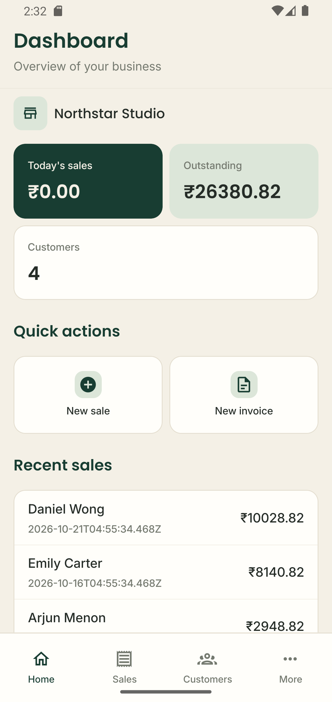
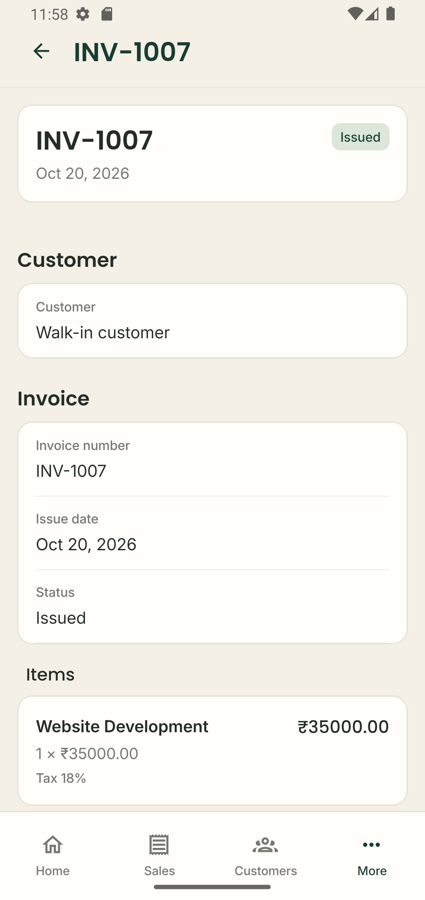
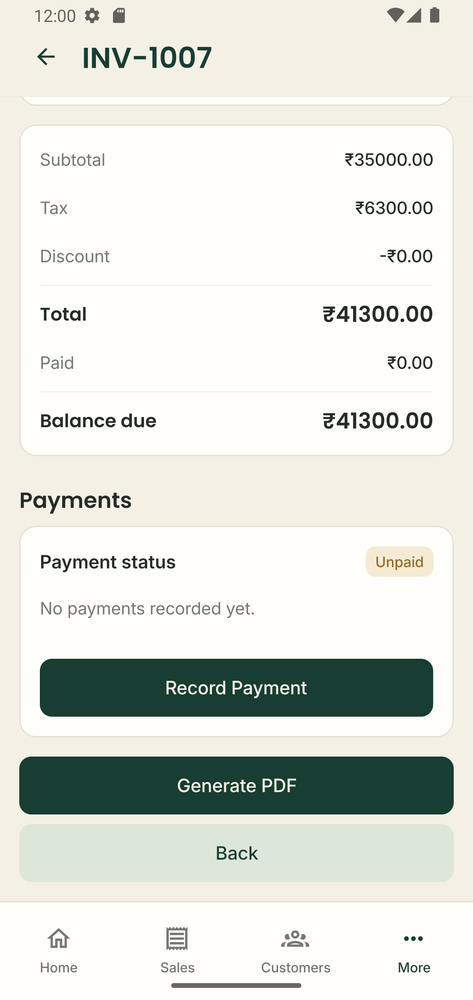
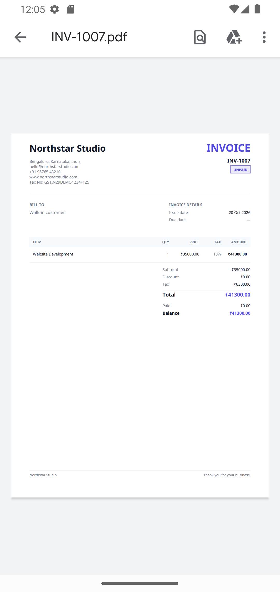
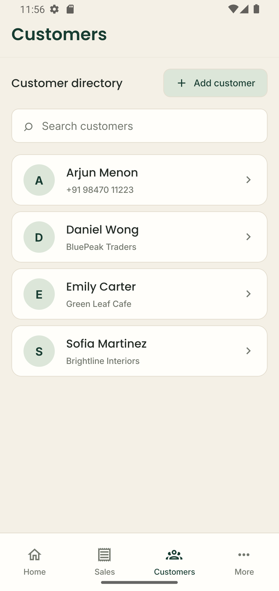
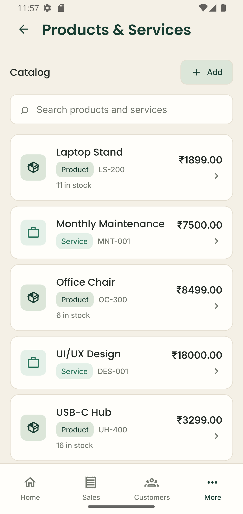
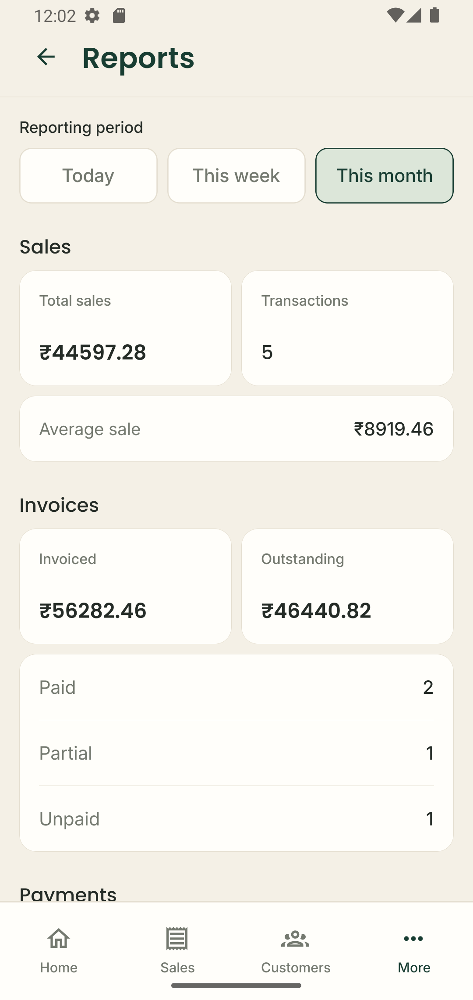
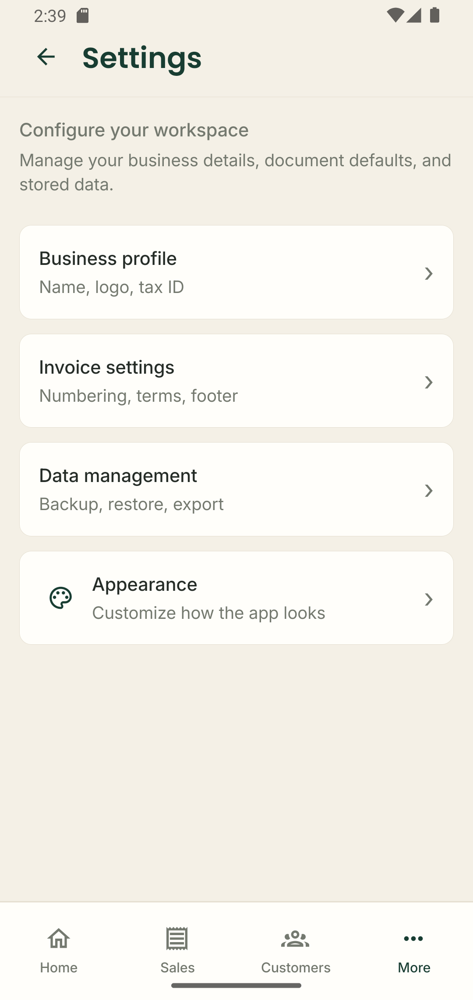
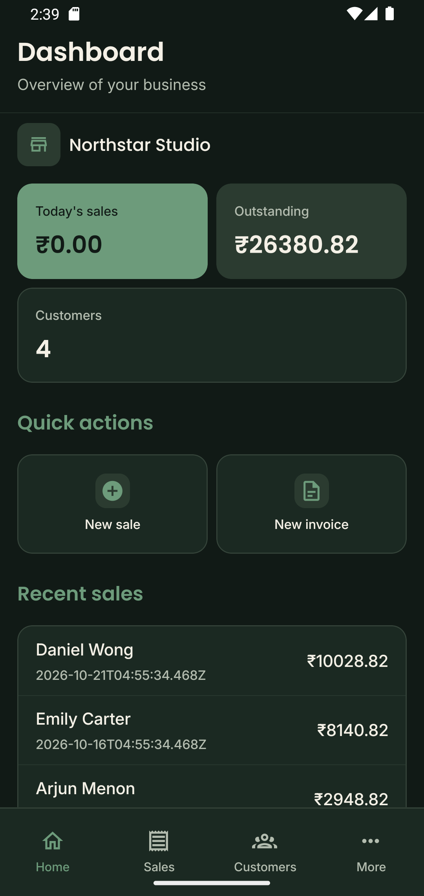

# Business Manager – React Native CLI App Template

A customizable, local-first business management app starter built with React Native CLI, TypeScript, and SQLite. It gives developers a working foundation for customer records, products and stock tracking, sales, invoices, payments, reports, and business settings.

Use it to study a real app structure, adapt the interface to your brand, and extend existing workflows instead of building every screen and data layer from scratch. Business data is stored locally on the device, so you can explore and customize the core experience without setting up a hosted backend.

> **Build verification:** The Android demo build has been exercised, and the iOS app has been built and launched in the iOS Simulator. These checks do not imply exhaustive device, workflow, or release-package coverage.

## Starter or full version?

The **Starter** is a customizable foundation for developers who want to explore and extend core business workflows. The **Full version** adds more advanced business and inventory workflows.

| Feature | Starter | Full |
| --- | :---: | :---: |
| Customer, product and service management | Included | Included |
| Sales recording and basic stock tracking | Included | Included |
| Invoice creation and PDF generation | Included | Included |
| Payment recording | Included | Included |
| Basic business reports | Included | Included |
| Business settings and appearance themes | Included | Included |
| Data backup and restore | Included | Included |
| Quotation management | — | Included |
| Quotation-to-invoice conversion | — | Included |
| Expense management | — | Included |
| Configurable low-stock thresholds and alerts | — | Included |
| Stock movement history | — | Included |
| Inventory valuation | — | Included |
| Expense reports and operational snapshot | — | Included |

**Starter inventory scope:** The Starter supports basic product stock tracking during sales. It does not include configurable low-stock thresholds, low-stock alerts or dashboard summaries, stock movement history, inventory valuation, or standalone manual stock adjustments.

**Get the Full version:** [Gumroad](https://hmuhammed7.gumroad.com/l/snpiki) · [Codester](https://www.codester.com/items/73514/business-manager-react-native-app-template?ref=hishammuhammed)

Both versions are local-first templates, not hosted services. Cloud synchronization and backend services need to be implemented separately if your project requires them.

## Screenshots

The following screenshots are included in `docs/assets/screenshots/`.

### Dashboard



### Invoice management

Invoice details are shown in two views so the line items and totals can be inspected separately.

| Invoice details | Invoice totals |
| --- | --- |
|  |  |

### Generated invoice PDF



### Customers and products

| Customer list | Product and service list |
| --- | --- |
|  |  |

### Business reports



### Settings



### Dark mode



## Features

The Starter includes these core workflows:

### Business operations
- Dashboard with business overview
- Customer records and customer details
- Products and services
- Sales records, sale items, and stock handling
- Business profile and invoice-related settings

### Invoicing and payments
- Invoice creation and invoice details
- Payment recording and invoice payment status
- PDF invoice generation using `pdf-lib`, embedded fonts, and business/customer data
- Currency, tax, and invoice-number settings stored with the business profile

### Reporting and data management
- Basic reports with Today, This week, and This month ranges
- Demo/sample data seeding for an empty installation
- JSON backup export and import
- Data reset with a confirmation step
- Light, dark, and system appearance preferences

## Technology stack

Versions below come from the repository's package configuration and native project files.

| Technology | Repository configuration |
| --- | --- |
| React Native | `0.87.1` |
| React | `19.2.3` |
| Language | TypeScript |
| Native application framework | React Native Community CLI `20.2.0` |
| Navigation | React Navigation 7 (bottom tabs and native stack) |
| Local database | `@op-engineering/op-sqlite` `^18.2.3` |
| PDF generation | `pdf-lib` `^1.17.1` and `@pdf-lib/fontkit` `^1.1.1` |
| Document and file handling | `@react-native-documents/picker`, `react-native-file-access`, and `react-native-share` |
| Icons | `@react-native-vector-icons/material-design-icons` |
| Safe areas and native screens | `react-native-safe-area-context`, `react-native-screens` |
| Package manager / lockfile | npm / `package-lock.json` (lockfile version 3) |

For the reasoning behind the main stack choices and their trade-offs, see [Technology Choices and Rationale](docs/ARCHITECTURE.md#technology-choices-and-rationale).

## How the Starter works

- **Local database:** Business records are stored in the on-device SQLite database, `business_manager.sqlite`. There is no automatic sync between devices.
- **Backup and recovery:** Export a JSON backup and store it somewhere safe outside the device. Import replaces current business data; reset clears business records and restores default business settings.
- **Sample data:** The app seeds demo records when the database meets the seeder's empty-install conditions. Review `src/database/seed/demoData.ts` and startup behavior before adapting the app for a real business.
- **Single business profile:** Each installation uses one business profile; multi-business and multi-tenant workflows are outside this Starter's current scope.
- **Release signing:** Android release builds require your own signing credentials. See [Android Release Signing](docs/INSTALLATION.md#build-a-signed-android-release) before creating a distribution build.

## Prerequisites

The package declares **Node.js `>=22.11.0`** in `package.json`. Android development also requires a compatible Java/JDK, Android Studio, Android SDK, and native build toolchain. Exact compatibility and setup details should be checked against the current React Native and Android project configuration before installation.

See [Installation](docs/INSTALLATION.md) for the detailed Windows/Android setup path and environment checks.

## Quick start: Windows and Android

These are the project scripts currently declared in `package.json`. Complete the native environment setup in the installation guide first.

1. Install the Node.js version required by `package.json` and configure the Android development environment.
2. From the repository root, install npm dependencies:

   ```powershell
   npm ci
   ```

3. Start Metro in a terminal:

   ```powershell
   npm start
   ```

4. With an Android emulator running or a device connected and configured for debugging, open a second terminal at the repository root and run:

   ```powershell
   npm run android
   ```

The Android command is configured as `react-native run-android`. A successful launch depends on the local Android SDK, Java, emulator/device, and native dependencies being configured correctly. For environment-specific setup and release build guidance, see [Installation](docs/INSTALLATION.md).

## Project structure

The following is a guide to the main source areas, not a complete file listing.

```text
.
├── App.tsx
├── index.js
├── app.json
├── package.json
├── android/                 # Android native project and Gradle configuration
├── ios/                     # iOS native project
├── src/
│   ├── assets/               # App icon and bundled assets
│   ├── components/           # Shared UI components
│   ├── config/               # Central app branding and formatting defaults
│   ├── database/
│   │   ├── migrations/       # SQLite schema creation and migrations
│   │   ├── repositories/     # Data access and business queries
│   │   └── seed/             # Demo data seeding
│   ├── hooks/                # Reusable screen/data hooks
│   ├── navigation/            # Tab and stack navigators
│   ├── screens/               # Feature screens
│   ├── services/pdf/          # PDF generation and bundled PDF fonts
│   ├── theme/                 # Colors, typography, spacing, theme provider
│   └── utils/                 # File and backup utilities
├── scripts/                  # Project utility scripts
└── docs/                     # Project guides
```

The application entry point is `index.js`, which registers `App.tsx`. App startup runs SQLite migrations and invokes demo-data seeding before the main navigation is displayed. Navigation is assembled in `src/navigation/AppNavigator.tsx` and `src/navigation/BottomTabNavigator.tsx`.

## Customization

The principal customization points currently visible in the source are:

- **App display name:** `app.json`, Android `android/app/src/main/res/values/strings.xml`, and iOS `ios/BusinessManager/Info.plist`. Native identifiers and related project references must be updated consistently when rebranding.
- **Application ID:** Android uses `com.businessmanager` in `android/app/build.gradle`. The iOS project still uses the React Native example bundle-identifier pattern (`org.reactjs.native.example...`); set a unique identifier you control in Xcode before creating a distribution build.
- **Brand defaults:** `src/config/appConfig.ts`.
- **Theme colors:** `src/theme/colors.ts`; theme preference is handled by `src/theme/ThemeProvider.tsx` and stored in SQLite.
- **Typography:** `src/theme/typography.ts`, with bundled font registrations in the native projects.
- **Business and invoice details:** the Business Profile and invoice settings screens, backed by the business settings repository.
- **Launcher icon:** the source asset is `src/assets/appIcon/BusinessManager.png`; Android launcher resources are under `android/app/src/main/res/`. Verify and update the relevant iOS asset catalog when rebranding for iOS.

See [Customization](docs/CUSTOMIZATION.md) for a file-by-file guide before changing identifiers, branding, or invoice presentation.

## Documentation

Start with these guides included in the Starter project:

- [Installation and Build Guide](docs/INSTALLATION.md) — prerequisites, Windows/Android setup, iOS/macOS setup, CocoaPods, Xcode workspace, signing, archive, and export.
- [Basic Usage Guide](docs/USAGE.md) — first launch, customers, products, sales, invoices, payments, reports, and data management.
- [Customization Guide](docs/CUSTOMIZATION.md) — app name, UI strings, brand settings, launch/splash screens, identifiers, icons, fonts, and invoice presentation.
- [Architecture](docs/ARCHITECTURE.md) — navigation, SQLite, repositories, hooks, and workflows.
- [Troubleshooting](docs/TROUBLESHOOTING.md) — setup and build issues.
- [Changelog](CHANGELOG.md) — project changes recorded for releases.
- [Starter source-available license](LICENSE) — permissions for personal and commercial use, customization, and client projects, with restrictions on redistributing the Starter as a reusable template.
- [Third-party notices](THIRD_PARTY_NOTICES.md) — bundled license texts and attribution guidance.
- [Third-party license inventory](docs/THIRD_PARTY_LICENSE_INVENTORY.md) — key bundled assets and dependency license references.

## Licensing

This repository is distributed under a **custom source-available license**. It permits developers to study, modify, and use the Starter in personal and commercial applications, including applications built for clients. You may publish and sell those finished applications and deliver their customized source code to clients. You may not redistribute or sell the Starter itself, or a substantially reusable derivative, as a standalone template, starter kit, boilerplate, or competing source-code product.

This is **not an OSI-approved open-source license**. Review the complete [Starter source-available license](LICENSE) before using the project. Third-party libraries, fonts, icons, and artwork remain subject to their own licenses; see [Third-party notices](THIRD_PARTY_NOTICES.md) and the [third-party license inventory](docs/THIRD_PARTY_LICENSE_INVENTORY.md).
